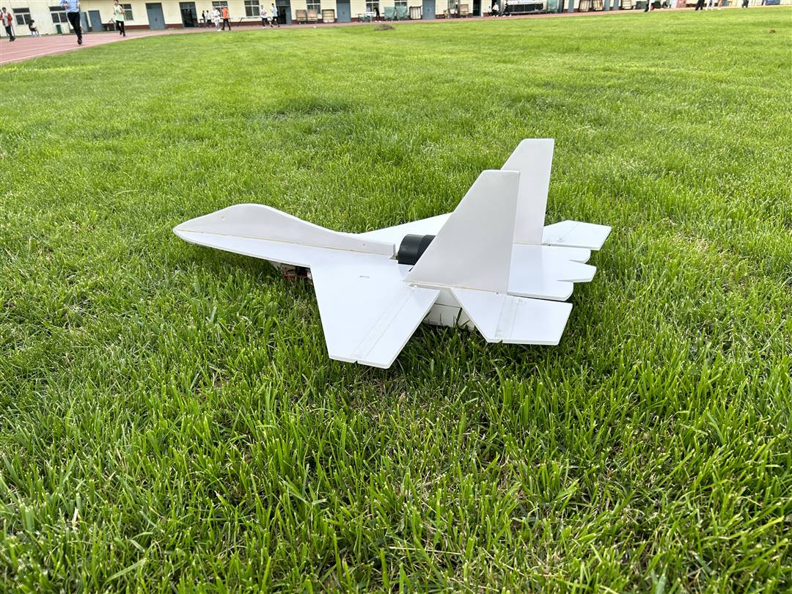
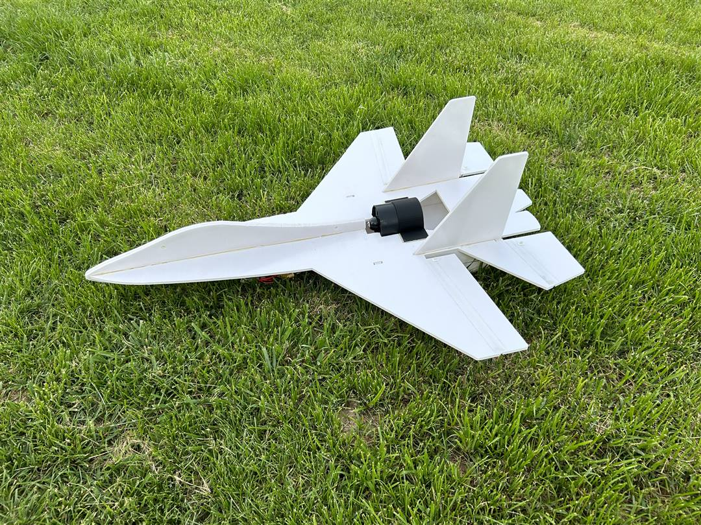
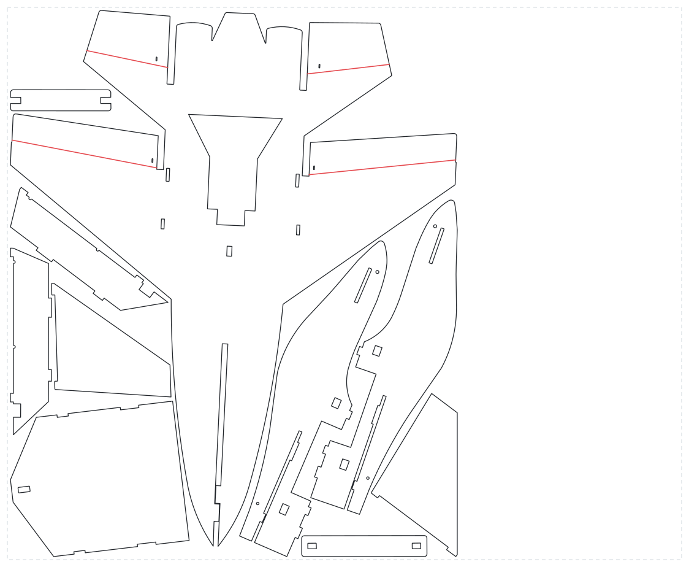
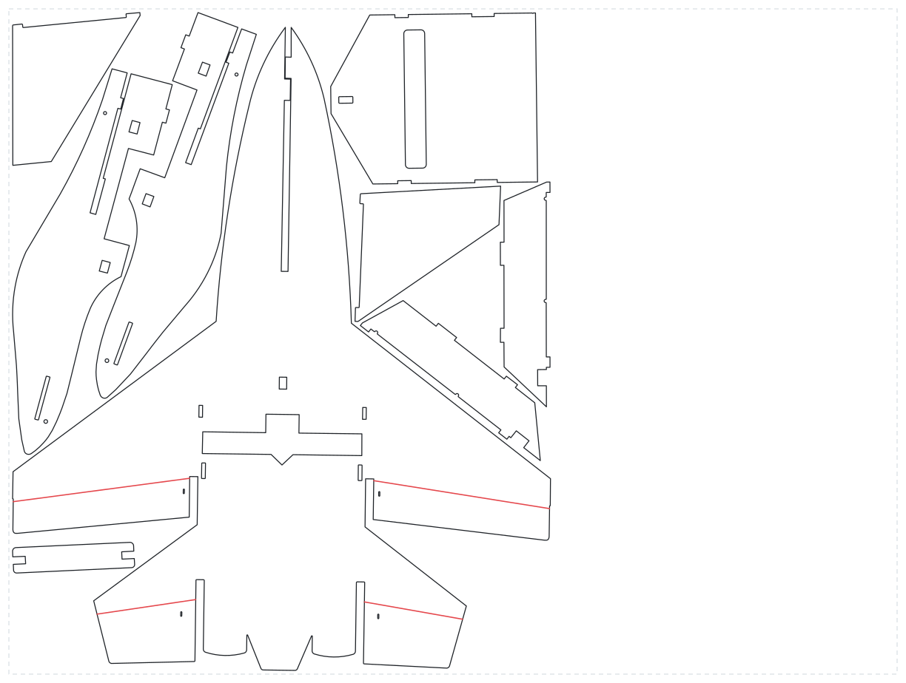

# 苏-27 KT 板航模

**一张 5 mm KT 板就能切完、大约 15 分钟拼好的苏-27。 
有涵道版和螺旋桨版两种。**

[English](README.md) · **简体中文**

### [⬇ 下载切割图纸（.zip）](https://github.com/chchaoo/RCPlane-SU27/releases/latest/download/su27-plans.zip)

 

https://github.com/ChengI-Chao/su27-kt-board-rc-plane/assets/166147704/855fd93b-0317-4d5f-8038-0bb181586ec9

## 基本参数

| | |
|---|---|
| **材料** | 5 mm 厚 KT 板（冷板） |
| **板材** | 1100 × 900 mm（涵道版）或 1200 × 900 mm（螺旋桨版） |
| **板材成本** | 约 3 元 |
| **拼装时间** | 约 15 分钟 |
| **重心** | 图纸上重心处有一个孔 |

## 两个版本

| | 涵道版 | 螺旋桨版 |
|---|---|---|
| **图纸** | [`plans/su27-edf-v4-1100x900.dxf`](plans/su27-edf-v4-1100x900.dxf) （原文件名：v4_涵道排版 x1 (1100x900).dxf） | [`plans/su27-prop-v7-1200x900.dxf`](plans/su27-prop-v7-1200x900.dxf) （原文件名：v7孔位调整_排版 x1 (1200x900).dxf） |
| **附加零件** | 3D 打印的涵道固定件：[`3d/edf-mount.stl`](3d/edf-mount.stl)（原文件名：涵道耳朵.STL） | 板机专用塑料电机座 |
| **电池** | 4S1P 2700 mAh | 3S1P 1300 mAh |
| **动力** | 涵道 | 2212 电机，1400 KV，7～8 寸桨 |

<table>
<tr>
<td align="center"><b>涵道版（v4）</b> </td>
<td align="center"><b>螺旋桨版（v7）</b> </td>
</tr>
</table>

> [!IMPORTANT]
> **红线：切一半深度**（舵面铰链）。**黑线：切透。**

图纸是以毫米为单位的普通 DXF 文件，激光切割软件、LightBurn、LibreCAD、AutoCAD 都能直接打开。没有激光切割机的话，按 1:1 打印出来手工切也可以。STL 文件可以直接在 GitHub 上 3D 预览：[点这里打开](3d/edf-mount.stl)。

## 需要准备

**工具：**（激光切割机）、热熔胶枪、裁纸刀、钢尺、钳子。

**材料：** 5 mm 厚 KT 板冷板、板机专用塑料电机座、舵角、金属调节器、铁丝拉杆、纤维胶带、魔术贴扎带、（碳纤维杆）。

**电子设备：** 电机或涵道、桨、电调、电池、舵机 × 2、遥控器、接收机。

## 其他设计

- [Modified-FTVersaWing](https://github.com/chchaoo/Modified-FTVersaWing)：带木质 FPV 机舱的 KT 板飞翼，基于 Flite Test Versa Wing 改进。

## 许可证

[CC BY-NC-SA 4.0](LICENSE)：可以自由制作、修改和分享，需要署名、不能商用，改版也要用同样的协议。
